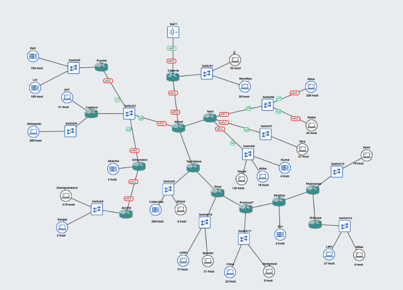
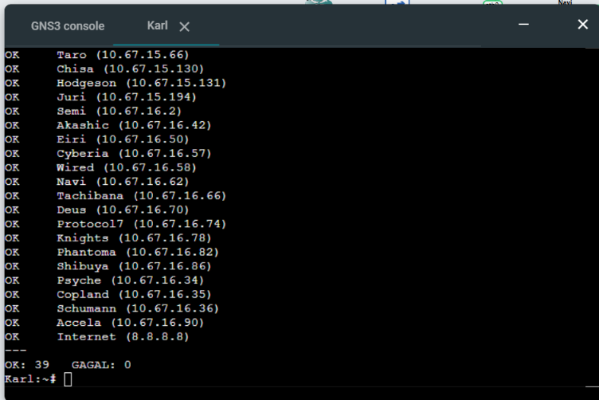

# Jarkom-Modul-4-2026-K-07

## Anggota Kelompok

| Nama | NRP |
| :--- | :--- |
| Evandra Raditya Fauzan | 5027251001 |
| Keisya Dira Anugerah | 5027251055 |

## Laporan Resmi

### GNS - VLSM

#### 1. Topologi

Berdasarkan hasil pemisahan rute yang dilakukan melalui spreadsheet, topologi jaringan terdiri atas **23 subnet**. Pembagian subnet disesuaikan dengan koneksi antar-node, switch, dan router sehingga setiap segmen jaringan memiliki alokasi alamat IP masing-masing.

#### 2. Perhitungan VLSM

Perhitungan subnet dilakukan menggunakan metode VLSM (*Variable Length Subnet Mask*) dengan mempertimbangkan kebutuhan host pada setiap segmen jaringan. Setiap switch merepresentasikan satu broadcast domain sehingga seluruh node yang terhubung pada switch tersebut, termasuk interface router yang mengarah ke switch, ditempatkan dalam satu subnet. Sementara itu, node yang terhubung langsung ke router, seperti Juri, Akashic, dan Eiri, memperoleh subnet tersendiri. Koneksi point-to-point antar-router juga dialokasikan dalam subnet terpisah menggunakan prefix `/30`.

Kebutuhan alamat IP setiap subnet dihitung berdasarkan jumlah host dan interface router yang terhubung di dalamnya. Setelah itu, dua alamat tambahan diperhitungkan untuk network ID dan broadcast address. Hasil kebutuhan alamat tersebut kemudian dibulatkan ke kapasitas blok berukuran pangkat dua terdekat yang dapat menampung seluruh alamat yang diperlukan.

Penentuan prefix dilakukan menggunakan rumus berikut:

`prefix = 32 - ceil(log2(Jumlah IP + 2))`

Setelah seluruh kebutuhan subnet diperoleh, alokasi dilakukan dengan mengurutkan subnet berdasarkan kebutuhan alamat IP dari yang terbesar hingga terkecil. Pengalokasian dimulai dari alamat `10.67.0.0` agar setiap subnet mendapatkan blok alamat yang sesuai dengan kapasitas kebutuhannya.

#### 3. Hasil Subnet

Hasil perhitungan menghasilkan 23 subnet dengan kebutuhan dan prefix yang berbeda-beda. Alokasi alamat IP tersebut diterapkan pada masing-masing router dan node sesuai dengan topologi jaringan yang telah dirancang.

Pada sisi router, konfigurasi jaringan dipisahkan menjadi dua bagian. 
- Network configuration pada `/etc/network/interfaces` digunakan untuk menetapkan alamat IP dan konfigurasi setiap interface. Pada interface terakhir, ditambahkan hook `up sh /root/init.sh` 
- File `/root/init.sh` digunakan untuk mengaktifkan IP forwarding, mengatur resolver, serta menambahkan static route. Khusus pada router Cyberia, konfigurasi tersebut juga mencakup MASQUERADE.

Pada sisi node, konfigurasi jaringan dilakukan melalui network configuration yang mencakup alamat IP, netmask, dan gateway.

Secara keseluruhan, kebutuhan alamat IP dari seluruh subnet mencapai **2.814 alamat**. Sementara itu, total kapasitas alamat yang dialokasikan berdasarkan ukuran blok masing-masing subnet adalah **4.188 alamat**, dengan **4.138 alamat usable** setelah dikurangi network ID dan broadcast address pada setiap subnet. Digunakan blok induk `/19` sebagai blok terkecil yang dapat menampung seluruh alokasi.

Dengan demikian, blok jaringan induk yang digunakan adalah **`10.67.0.0/19`**, dengan rentang alamat `10.67.0.0` hingga `10.67.31.255`. Proses alokasi subnet dimulai dari `10.67.0.0` dan berakhir pada alamat `10.67.16.91`.

Rincian perhitungan kebutuhan host, prefix, network ID, dan rentang alamat setiap subnet dapat dilihat pada spreadsheet yang disertakan dalam direktori `result/`.

#### 4. Pengujian

Digunakan script ping-all untuk menguji konektivitas antar-node. Hasil pengujian menunjukkan bahwa seluruh node dapat saling terhubung, menandakan bahwa konfigurasi jaringan telah berhasil diterapkan dengan baik.

