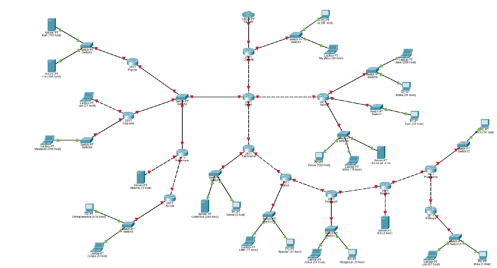
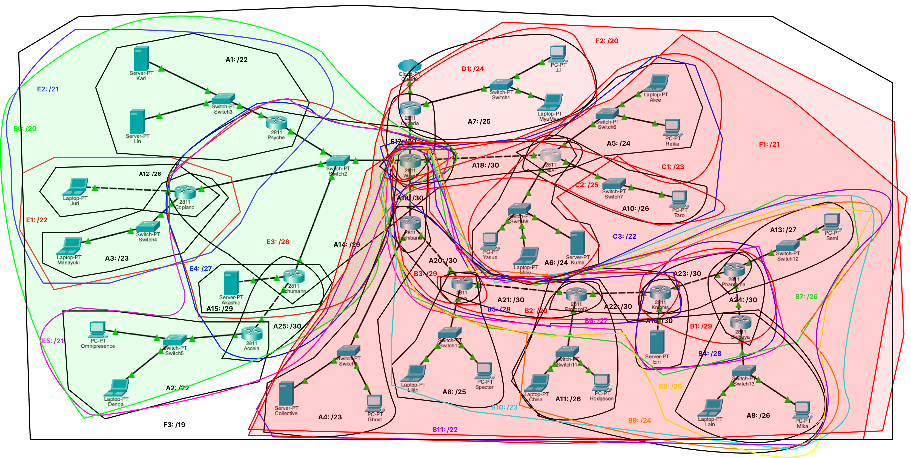
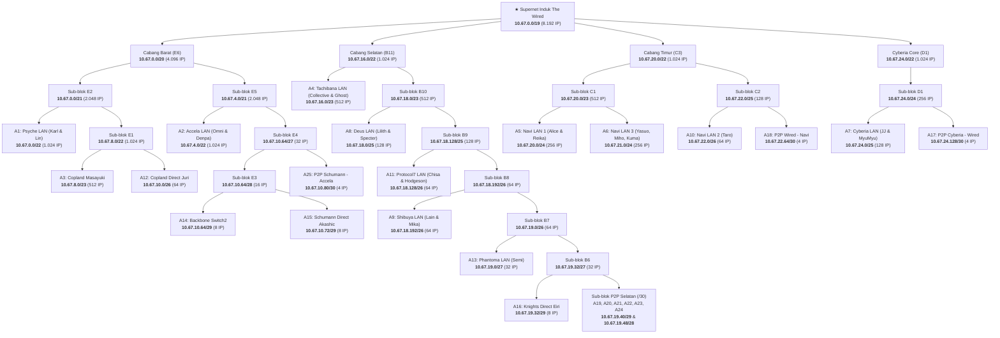
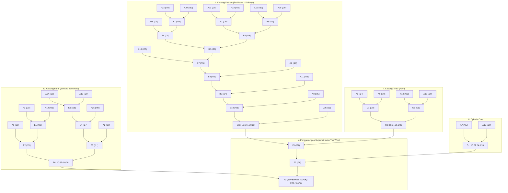

# Kelompok K-07 Laporan Resmi Praktikum Jarkom Modul 4

**Komunikasi Data & Jaringan Komputer 2026**  
*Serial Experiments Lain Layer:04 — The Wired Expansion*

---

## Anggota Kelompok

| Nama | NRP |
| :--- | :--- |
| **Evandra Raditya Fauzan** | 5027251001 |
| **Keisya Dira Anugerah** | 5027251055 |

---

## Daftar Isi

1. [Spesifikasi Masalah & Ketentuan Modul](#spesifikasi-masalah--ketentuan-modul)
2. [Bagian I: GNS3 — VLSM (Variable Length Subnet Mask)](#bagian-i-gns3--vlsm-variable-length-subnet-mask)
   - [1.1 Topologi Jaringan GNS3](#11-topologi-jaringan-gns3)
   - [1.2 Metodologi & Rumus Perhitungan VLSM](#12-metodologi--rumus-perhitungan-vlsm)
   - [1.3 Analisis Kebutuhan Host Tiap Subnet](#13-analisis-kebutuhan-host-tiap-subnet)
   - [1.4 Tabel Alokasi Alamat IP (VLSM)](#14-tabel-alokasi-alamat-ip-vlsm)
   - [1.5 Implementasi Konfigurasi Router & Node Linux](#15-implementasi-konfigurasi-router--node-linux)
   - [1.6 Pengujian Konektivitas GNS3 (Ping-All)](#16-pengujian-konektivitas-gns3-ping-all)
3. [Bagian II: Cisco Packet Tracer (CPT) — CIDR (Classless Inter-Domain Routing)](#bagian-ii-cisco-packet-tracer-cpt--cidr-classless-inter-domain-routing)
   - [2.1 Topologi Jaringan Cisco Packet Tracer](#21-topologi-jaringan-cisco-packet-tracer)
   - [2.2 Konsep CIDR & Hierarki Pengelompokan Subnet](#22-konsep-cidr--hierarki-pengelompokan-subnet)
   - [2.3 Diagram Pembagian IP & Lingkaran Hierarki CIDR](#23-diagram-pembagian-ip--lingkaran-hierarki-cidr)
   - [2.4 Pohon Penggabungan Subnet CIDR (Hierarchical Tree Aggregation)](#24-pohon-penggabungan-subnet-cidr-hierarchical-tree-aggregation)
   - [2.5 Tabel Pembagian Alamat IP CIDR](#25-tabel-pembagian-alamat-ip-cidr)
   - [2.6 Tabel Summary Route & Supernetting](#26-tabel-summary-route--supernetting)
   - [2.7 Konfigurasi Perangkat Cisco IOS (Routers) & End Devices](#27-konfigurasi-perangkat-cisco-ios-routers--end-devices)
   - [2.8 Pengujian & Verifikasi Konektivitas CPT (Ping Verification)](#28-pengujian--verifikasi-konektivitas-cpt-ping-verification)
4. [File Hasil Praktikum (Deliverables)](#file-hasil-praktikum-deliverables)

---

## Spesifikasi Masalah & Ketentuan Modul

Lain Iwakura memperluas arsitektur **The Wired** ke berbagai distrik Tokyo (Cyberia, Tachibana, Knights, Shibuya, Navi, Psyche, Copland, Schumann, dan Accela). Seluruh lalu lintas keluar/dunia nyata hanya terhubung melalui Router Cyberia ke NAT/Cloud.

Sesuai aturan praktikum:
- **Prefix Kelompok K-07**: `10.67`
- **Aturan Classless**: Pengerjaan pada Cisco Packet Tracer (CPT) dan GNS3 wajib menggunakan metode perhitungan *classless* yang berbeda:
  - **GNS3**: Menggunakan metode **VLSM** (*Variable Length Subnet Mask*).
  - **Cisco Packet Tracer (CPT)**: Menggunakan metode **CIDR** (*Classless Inter-Domain Routing*) dengan pengelompokan hierarki bertingkat (*tree summarization*).
- **Efisiensi Routing**: Routing static wajib dibuat seefisien mungkin memanfaatkan *summary route* agar ukuran tabel rute minimal tanpa mengorbankan keterhubungan antar-node.
- **Konektivitas**: Seluruh end device pada topologi wajib dapat saling berkomunikasi (*ping-all 100% success*).

---

## Bagian I: GNS3 — VLSM (Variable Length Subnet Mask)

### 1.1 Topologi Jaringan GNS3

Topologi pada GNS3 terdiri dari **13 router virtual** (menggunakan Docker image Alpine/Debinet), **13 switch**, dan **21 end device/node**. Total terdapat **25 subnet (A1–A25)** yang memisahkan masing-masing segmen LAN host, koneksi point-to-point (P2P) antar-router, serta satu segmen *multi-access* backbone pada Switch2.


---

### 1.2 Metodologi & Rumus Perhitungan VLSM

Metode VLSM mengalokasikan ruang alamat IP berdasarkan kebutuhan riil setiap segmen, mulai dari kebutuhan blok terbesar ke kebutuhan blok terkecil secara berurutan.

1. **Perhitungan Kebutuhan IP Efektif per Subnet**:
   $$\text{Kebutuhan IP} = \text{Jumlah Host} + \text{Jumlah Interface Router} + 2 \, (\text{Network ID} + \text{Broadcast})$$
2. **Penentuan Kapasitas Blok & Netmask**:
   Ukuran blok ditentukan sebesar bilangan pangkat dua terkecil yang dapat menampung kebutuhan IP tersebut:
   $$\text{Block Size} = 2^n \quad \text{di mana } 2^n \ge \text{Kebutuhan IP}$$
   $$\text{Prefix} = 32 - n = 32 - \lceil \log_2(\text{Jumlah Host} + \text{Router Interface} + 2) \rceil$$
3. **Pengurutan Alokasi**:
   Seluruh subnet diurutkan *descending* (terbesar ke terkecil: `/22` $\to$ `/23` $\to$ `/24` $\to$ `/25` $\to$ `/26` $\to$ `/27` $\to$ `/29` $\to$ `/30`), lalu dialokasikan secara kontigu dimulai dari `10.67.0.0`.

---

### 1.3 Analisis Kebutuhan Host Tiap Subnet

Berdasarkan topologi yang diberikan, berikut adalah rincian kebutuhan dari ke-25 subnet:

| Label | Segmen / Rute Jaringan | Host | Router Iface | Total Butuh | Kapasitas Blok | Prefix |
| :---: | :--- | :---: | :---: | :---: | :---: | :---: |
| **A1** | Psyche LAN (Karl: 700, Lin: 180 via Switch3) | 880 | 1 | 881 | 1024 | `/22` |
| **A2** | Accela LAN (Omnipresence: 510, Denpa: 3 via Switch5) | 513 | 1 | 514 | 1024 | `/22` |
| **A3** | Copland LAN (Masayuki: 300 via Switch4) | 300 | 1 | 301 | 512 | `/23` |
| **A4** | Tachibana LAN (Collective: 260, Ghost: 6 via Switch9) | 266 | 1 | 267 | 512 | `/23` |
| **A5** | Navi LAN 1 (Alice: 208, Reika: 45 via Switch6) | 253 | 1 | 254 | 256 | `/24` |
| **A6** | Navi LAN 3 (Yasuo: 120, Miho: 18, Kuma: 4 via Switch8) | 142 | 1 | 143 | 256 | `/24` |
| **A7** | Cyberia LAN (JJ: 95, MyuMyu: 30 via Switch1) | 125 | 1 | 126 | 128 | `/25` |
| **A8** | Deus LAN (Lilith: 77, Specter: 21 via Switch10) | 98 | 1 | 99 | 128 | `/25` |
| **A9** | Shibuya LAN (Lain: 57, Mika: 4 via Switch13) | 61 | 1 | 62 | 64 | `/26` |
| **A10** | Navi LAN 2 (Taro: 57 via Switch7) | 57 | 1 | 58 | 64 | `/26` |
| **A11** | Protocol7 LAN (Chisa: 23, Hodgeson: 9 via Switch11) | 32 | 1 | 33 | 64 | `/26` |
| **A12** | Copland Direct Link (Juri: 31) | 31 | 1 | 32 | 64 | `/26` |
| **A13** | Phantoma LAN (Semi: 14 via Switch12) | 14 | 1 | 15 | 32 | `/27` |
| **A14** | Switch2 Backbone (Wired, Psyche, Copland, Schumann) | 0 | 4 | 4 | 8 | `/29` |
| **A15** | Schumann Direct Link (Akashic: 3) | 3 | 1 | 4 | 8 | `/29` |
| **A16** | Knights Direct Link (Eiri: 2) | 2 | 1 | 3 | 8 | `/29` |
| **A17** | P2P Cyberia — Wired | 0 | 2 | 2 | 4 | `/30` |
| **A18** | P2P Wired — Navi | 0 | 2 | 2 | 4 | `/30` |
| **A19** | P2P Wired — Tachibana | 0 | 2 | 2 | 4 | `/30` |
| **A20** | P2P Tachibana — Deus | 0 | 2 | 2 | 4 | `/30` |
| **A21** | P2P Deus — Protocol7 | 0 | 2 | 2 | 4 | `/30` |
| **A22** | P2P Protocol7 — Knights | 0 | 2 | 2 | 4 | `/30` |
| **A23** | P2P Knights — Phantoma | 0 | 2 | 2 | 4 | `/30` |
| **A24** | P2P Phantoma — Shibuya | 0 | 2 | 2 | 4 | `/30` |
| **A25** | P2P Schumann — Accela | 0 | 2 | 2 | 4 | `/30` |
| **Total** | **Seluruh Subnet The Wired** | **2.780** | **34** | **2.814** | **4.188** | **/19** |

*Catatan: Blok supernet terkecil yang dapat menampung alokasi 4.188 IP ini adalah `/19` (8.192 alamat IP).*

---

### 1.4 Tabel Alokasi Alamat IP (VLSM)

Pengalokasian alamat IP VLSM dilakukan secara berurutan mulai dari alamat `10.67.0.0`:

| Subnet | Network ID | Netmask | Broadcast | Range IP Usable |
| :---: | :---: | :---: | :---: | :---: |
| **A1** | `10.67.0.0` | `255.255.252.0 (/22)` | `10.67.3.255` | `10.67.0.1 - 10.67.3.254` |
| **A2** | `10.67.4.0` | `255.255.252.0 (/22)` | `10.67.7.255` | `10.67.4.1 - 10.67.7.254` |
| **A3** | `10.67.8.0` | `255.255.254.0 (/23)` | `10.67.9.255` | `10.67.8.1 - 10.67.9.254` |
| **A4** | `10.67.10.0` | `255.255.254.0 (/23)` | `10.67.11.255` | `10.67.10.1 - 10.67.11.254` |
| **A5** | `10.67.12.0` | `255.255.255.0 (/24)` | `10.67.12.255` | `10.67.12.1 - 10.67.12.254` |
| **A6** | `10.67.13.0` | `255.255.255.0 (/24)` | `10.67.13.255` | `10.67.13.1 - 10.67.13.254` |
| **A7** | `10.67.14.0` | `255.255.255.128 (/25)` | `10.67.14.127` | `10.67.14.1 - 10.67.14.126` |
| **A8** | `10.67.14.128` | `255.255.255.128 (/25)` | `10.67.14.255` | `10.67.14.129 - 10.67.14.254` |
| **A9** | `10.67.15.0` | `255.255.255.192 (/26)` | `10.67.15.63` | `10.67.15.1 - 10.67.15.62` |
| **A10** | `10.67.15.64` | `255.255.255.192 (/26)` | `10.67.15.127` | `10.67.15.65 - 10.67.15.126` |
| **A11** | `10.67.15.128` | `255.255.255.192 (/26)` | `10.67.15.191` | `10.67.15.129 - 10.67.15.190` |
| **A12** | `10.67.15.192` | `255.255.255.192 (/26)` | `10.67.15.255` | `10.67.15.193 - 10.67.15.254` |
| **A13** | `10.67.16.0` | `255.255.255.224 (/27)` | `10.67.16.31` | `10.67.16.1 - 10.67.16.30` |
| **A14** | `10.67.16.32` | `255.255.255.248 (/29)` | `10.67.16.39` | `10.67.16.33 - 10.67.16.38` |
| **A15** | `10.67.16.40` | `255.255.255.248 (/29)` | `10.67.16.47` | `10.67.16.41 - 10.67.16.46` |
| **A16** | `10.67.16.48` | `255.255.255.248 (/29)` | `10.67.16.55` | `10.67.16.49 - 10.67.16.54` |
| **A17** | `10.67.16.56` | `255.255.255.252 (/30)` | `10.67.16.59` | `10.67.16.57 - 10.67.16.58` |
| **A18** | `10.67.16.60` | `255.255.255.252 (/30)` | `10.67.16.63` | `10.67.16.61 - 10.67.16.62` |
| **A19** | `10.67.16.64` | `255.255.255.252 (/30)` | `10.67.16.67` | `10.67.16.65 - 10.67.16.66` |
| **A20** | `10.67.16.68` | `255.255.255.252 (/30)` | `10.67.16.71` | `10.67.16.69 - 10.67.16.70` |
| **A21** | `10.67.16.72` | `255.255.255.252 (/30)` | `10.67.16.75` | `10.67.16.73 - 10.67.16.74` |
| **A22** | `10.67.16.76` | `255.255.255.252 (/30)` | `10.67.16.79` | `10.67.16.77 - 10.67.16.78` |
| **A23** | `10.67.16.80` | `255.255.255.252 (/30)` | `10.67.16.83` | `10.67.16.81 - 10.67.16.82` |
| **A24** | `10.67.16.84` | `255.255.255.252 (/30)` | `10.67.16.87` | `10.67.16.85 - 10.67.16.86` |
| **A25** | `10.67.16.88` | `255.255.255.252 (/30)` | `10.67.16.91` | `10.67.16.89 - 10.67.16.90` |

---

### 1.5 Implementasi Konfigurasi Router & Node Linux

Pada environment GNS3 dengan container Docker, konfigurasi didistribusikan ke direktori masing-masing node di [`routings/vlsm/`](routings/vlsm/):
- **`/etc/network/interfaces`**: Menetapkan alamat IP, netmask, serta gateway statis untuk setiap interface jaringan. Pada interface terakhir router, dipasang hook eksekusi otomatis:
  ```bash
  up sh /root/init.sh
  ```
- **`/root/init.sh`**: Mengaktifkan forwarding kernel Linux (`sysctl -w net.ipv4.ip_forward=1`), resolver DNS, serta static route via `ip route add`.
- **NAT Masquerade di Router Cyberia**: Karena Cyberia merupakan pintu keluar tunggal, iptables diatur untuk melakukan masquerade ke interface luar (NAT):
  ```bash
  iptables -t nat -A POSTROUTING -o eth0 -j MASQUERADE
  ```

---

### 1.6 Pengujian Konektivitas GNS3 (Ping-All)

Pengujian dilakukan dengan mengeksekusi script otomatis yang menguji ping dari setiap node ke semua node lainnya di dalam jaringan The Wired. Hasil pengujian menunjukkan **100% SUCCESS** tanpa packet loss.


---

## Bagian II: Cisco Packet Tracer (CPT) — CIDR (Classless Inter-Domain Routing)

### 2.1 Topologi Jaringan Cisco Packet Tracer

Pada Cisco Packet Tracer, topologi dibangun menggunakan **Router Cisco Seri 2811** modular yang dilengkapi ekspansi modul **NM-2FE2W** pada Slot 1 untuk menyediakan antarmuka FastEthernet tambahan (`Fa1/0` dan `Fa1/1`). 



Arsitektur antarmuka router utama:
- **Cyberia**: `Fa1/0` ke Cloud0 (NAT/WAN ITS), `Fa0/0` ke Wired, `Fa0/1` ke Switch1 (JJ & MyuMyu).
- **Wired (Core Hub)**: `Fa0/0` ke Cyberia, `Fa0/1` ke Switch2 (West Backbone), `Fa1/0` ke Tachibana (South Branch), `Fa1/1` ke Navi (East Branch).
- **Backbone Switch2**: Menghubungkan Router Wired, Psyche, Copland, dan Schumann secara multi-access (`10.67.10.64/29`).

---

### 2.2 Konsep CIDR & Hierarki Pengelompokan Subnet

Berbeda dengan VLSM yang mengurutkan subnet semata-mata berdasarkan ukuran host secara flat, **CIDR (*Classless Inter-Domain Routing*)** menerapkan pengelompokan topologis (*topological aggregation*). Subnet-subnet yang berada dalam satu cabang fisik/geografis digabungkan menjadi blok supernet yang lebih besar sehingga router backbone cukup memiliki **1 rute ringkasan (summary route)** ke cabang tersebut.

Topologi The Wired dibagi menjadi 4 grup wilayah besar:
1. **Cabang Barat (`E6`)**: Menghubungkan seluruh segmen di belakang Switch2 (Psyche, Copland, Schumann, Accela).
2. **Cabang Selatan (`B11`)**: Rantai router linear dari Tachibana $\to$ Deus $\to$ Protocol7 $\to$ Knights $\to$ Phantoma $\to$ Shibuya.
3. **Cabang Timur (`C3`)**: Tiga segmen LAN milik router Navi (Switch6, Switch7, Switch8).
4. **Cyberia Core (`D1`)**: Segmen LAN Cyberia dan link interkoneksi Cyberia–Wired.

---

### 2.3 Diagram Pembagian IP & Lingkaran Hierarki CIDR

Pembagian IP berbasis hierarki CIDR divisualisasikan dengan diagram lingkaran bertingkat. Lingkaran yang lebih besar melingkupi lingkaran-lingkaran di dalamnya, menggambarkan hierarki *route aggregation* dari tingkat subnet fisik hingga supernet induk.

#### 1. Diagram Lingkaran Topologi Resmi (Hasil Anotasi Topologi)
Batas pengelompokan lingkaran setiap subnet dan cabang supernet langsung digambarkan di atas diagram topologi fisik:



#### 2. Peta Hierarki CIDR Alamat IP

Peta struktur pohon hierarki pengalokasian alamat IP The Wired dari Supernet Induk `/19` hingga masing-masing subnet:



> **Makna Tingkatan & Warna Lingkaran Hierarki**:
> - **Level 0 (Supernet Induk - Kotak Terluar)**: `10.67.0.0/19` (8.192 alamat IP). Melingkupi seluruh entitas The Wired dan menjadi rute summary tunggal di router Cyberia menuju Cloud/NAT.
> - **Level 1 (Grup Besar / Wilayah)**:
>   - **Cabang Barat (Lingkaran Hijau `E6`)**: `10.67.0.0/20` (4.096 IP) mencakup Switch2, Psyche, Copland, Schumann, dan Accela.
>   - **Cabang Selatan (Lingkaran Merah `B11`)**: `10.67.16.0/22` (1.024 IP) mencakup Tachibana, Deus, Protocol7, Knights, Phantoma, dan Shibuya.
>   - **Cabang Timur (Lingkaran Merah Muda `C3`)**: `10.67.20.0/22` (1.024 IP) mencakup seluruh segmen LAN Navi.
>   - **Cyberia Core (`D1`)**: `10.67.24.0/22` (1.024 IP) mencakup Switch1 dan link P2P Cyberia–Wired.
> - **Level 2 & Level 3 (Grup Menengah & Subnet Fisik A1–A25)**: Lingkaran-lingkaran lokal per switch/segmen point-to-point.

---

### 2.4 Pohon Penggabungan Subnet CIDR (Hierarchical Tree Aggregation)

Proses penggabungan berpasangan (*binary pairing aggregation*) dari subnet fisik hingga terbentuk Supernet Induk The Wired:



#### Tabel Rincian Langkah Penggabungan CIDR:

| Kode Gabungan | Subnet 1 | Netmask 1 | Subnet 2 | Netmask 2 | Netmask Gabungan | Keterangan Wilayah |
| :---: | :---: | :---: | :---: | :---: | :---: | :--- |
| **B1** | A23 | `/30` | A24 | `/30` | `/29` | P2P Knights–Phantoma & Phantoma–Shibuya |
| **B2** | A21 | `/30` | A22 | `/30` | `/29` | P2P Deus–Protocol7 & Protocol7–Knights |
| **B3** | A19 | `/30` | A20 | `/30` | `/29` | P2P Wired–Tachibana & Tachibana–Deus |
| **B4** | A16 | `/29` | B1 | `/29` | `/28` | Knights Direct (Eiri) + B1 |
| **B5** | B2 | `/29` | B3 | `/29` | `/28` | Gabungan P2P Selatan Tengah |
| **B6** | B4 | `/28` | B5 | `/28` | `/27` | Gabungan P2P & Direct Selatan |
| **B7** | A13 | `/27` | B6 | `/27` | `/26` | Phantoma LAN (Semi) + B6 |
| **B8** | B7 | `/26` | A9 | `/26` | `/25` | B7 + Shibuya LAN (Lain, Mika) |
| **B9** | B8 | `/25` | A11 | `/26` | `/24` | B8 + Protocol7 LAN (Chisa, Hodgeson) |
| **B10** | B9 | `/24` | A8 | `/25` | `/23` | B9 + Deus LAN (Lilith, Specter) |
| **B11** | B10 | `/23` | A4 | `/23` | `/22` | **Summary Cabang Selatan (Tachibana Line)** |
| **C1** | A5 | `/24` | A6 | `/24` | `/23` | Navi LAN 1 + Navi LAN 3 |
| **C2** | A10 | `/26` | A18 | `/30` | `/25` | Navi LAN 2 + P2P Wired–Navi |
| **C3** | C1 | `/23` | C2 | `/25` | `/22` | **Summary Cabang Timur (Navi Area)** |
| **D1** | A7 | `/25` | A17 | `/30` | `/24` | **Summary Cyberia Core** (LAN JJ, MyuMyu + P2P Cyberia–Wired) |
| **E1** | A3 | `/23` | A12 | `/26` | `/22` | Copland LAN Masayuki + Copland Direct Juri |
| **E2** | A1 | `/22` | E1 | `/22` | `/21` | Psyche LAN (Karl, Lin) + E1 |
| **E3** | A14 | `/29` | A15 | `/29` | `/28` | Backbone Switch2 + Schumann Direct Akashic |
| **E4** | E3 | `/28` | A25 | `/30` | `/27` | E3 + P2P Schumann–Accela |
| **E5** | E4 | `/27` | A2 | `/22` | `/21` | E4 + Accela LAN (Omnipresence, Denpa) |
| **E6** | E2 | `/21` | E5 | `/21` | `/20` | **Summary Cabang Barat (Switch2 Backbone)** |
| **F1** | B11 | `/22` | C3 | `/22` | `/21` | Gabungan Selatan (`B11`) + Timur (`C3`) |
| **F2** | F1 | `/21` | D1 | `/24` | `/20` | Gabungan F1 + Cyberia Core (`D1`) |
| **F3** | E6 | `/20` | F2 | `/20` | `/19` | **★ SUPERNET INDUK THE WIRED (`10.67.0.0/19`)** |

---

### 2.5 Tabel Pembagian Alamat IP CIDR

Dengan pengelompokan hierarki CIDR yang tertata per wilayah, alokasi alamat IP fisik (A1–A25) pada Cisco Packet Tracer adalah sebagai berikut:

| Subnet | Deskripsi Segmen | Network ID | Netmask | Broadcast | Range IP Usable |
| :---: | :--- | :---: | :---: | :---: | :---: |
| **A1** | Psyche LAN (Karl, Lin via Sw3) | `10.67.0.0` | `255.255.252.0 (/22)` | `10.67.3.255` | `10.67.0.1 - 10.67.3.254` |
| **A2** | Accela LAN (Omnipresence, Denpa via Sw5) | `10.67.4.0` | `255.255.252.0 (/22)` | `10.67.7.255` | `10.67.4.1 - 10.67.7.254` |
| **A3** | Copland LAN (Masayuki via Sw4) | `10.67.8.0` | `255.255.254.0 (/23)` | `10.67.9.255` | `10.67.8.1 - 10.67.9.254` |
| **A4** | Tachibana LAN (Collective, Ghost via Sw9) | `10.67.16.0` | `255.255.254.0 (/23)` | `10.67.17.255` | `10.67.16.1 - 10.67.17.254` |
| **A5** | Navi LAN 1 (Alice, Reika via Sw6) | `10.67.20.0` | `255.255.255.0 (/24)` | `10.67.20.255` | `10.67.20.1 - 10.67.20.254` |
| **A6** | Navi LAN 3 (Yasuo, Miho, Kuma via Sw8) | `10.67.21.0` | `255.255.255.0 (/24)` | `10.67.21.255` | `10.67.21.1 - 10.67.21.254` |
| **A7** | Cyberia LAN (JJ, MyuMyu via Sw1) | `10.67.24.0` | `255.255.255.128 (/25)` | `10.67.24.127` | `10.67.24.1 - 10.67.24.126` |
| **A8** | Deus LAN (Lilith, Specter via Sw10) | `10.67.18.0` | `255.255.255.128 (/25)` | `10.67.18.127` | `10.67.18.1 - 10.67.18.126` |
| **A9** | Shibuya LAN (Lain, Mika via Sw13) | `10.67.18.192` | `255.255.255.192 (/26)` | `10.67.18.255` | `10.67.18.193 - 10.67.18.254` |
| **A10** | Navi LAN 2 (Taro via Sw7) | `10.67.22.0` | `255.255.255.192 (/26)` | `10.67.22.63` | `10.67.22.1 - 10.67.22.62` |
| **A11** | Protocol7 LAN (Chisa, Hodgeson via Sw11) | `10.67.18.128` | `255.255.255.192 (/26)` | `10.67.18.191` | `10.67.18.129 - 10.67.18.190` |
| **A12** | Copland Direct Link (Juri) | `10.67.10.0` | `255.255.255.192 (/26)` | `10.67.10.63` | `10.67.10.1 - 10.67.10.62` |
| **A13** | Phantoma LAN (Semi via Sw12) | `10.67.19.0` | `255.255.255.224 (/27)` | `10.67.19.31` | `10.67.19.1 - 10.67.19.30` |
| **A14** | Switch2 Backbone (Multi-access) | `10.67.10.64` | `255.255.255.248 (/29)` | `10.67.10.71` | `10.67.10.65 - 10.67.10.70` |
| **A15** | Schumann Direct Link (Akashic) | `10.67.10.72` | `255.255.255.248 (/29)` | `10.67.10.79` | `10.67.10.73 - 10.67.10.78` |
| **A16** | Knights Direct Link (Eiri) | `10.67.19.32` | `255.255.255.248 (/29)` | `10.67.19.39` | `10.67.19.33 - 10.67.19.38` |
| **A17** | P2P Cyberia — Wired | `10.67.24.128` | `255.255.255.252 (/30)` | `10.67.24.131` | `10.67.24.129 - 10.67.24.130` |
| **A18** | P2P Wired — Navi | `10.67.22.64` | `255.255.255.252 (/30)` | `10.67.22.67` | `10.67.22.65 - 10.67.22.66` |
| **A19** | P2P Wired — Tachibana | `10.67.19.40` | `255.255.255.252 (/30)` | `10.67.19.43` | `10.67.19.41 - 10.67.19.42` |
| **A20** | P2P Tachibana — Deus | `10.67.19.44` | `255.255.255.252 (/30)` | `10.67.19.47` | `10.67.19.45 - 10.67.19.46` |
| **A21** | P2P Deus — Protocol7 | `10.67.19.48` | `255.255.255.252 (/30)` | `10.67.19.51` | `10.67.19.49 - 10.67.19.50` |
| **A22** | P2P Protocol7 — Knights | `10.67.19.52` | `255.255.255.252 (/30)` | `10.67.19.55` | `10.67.19.53 - 10.67.19.54` |
| **A23** | P2P Knights — Phantoma | `10.67.19.56` | `255.255.255.252 (/30)` | `10.67.19.59` | `10.67.19.57 - 10.67.19.58` |
| **A24** | P2P Phantoma — Shibuya | `10.67.19.60` | `255.255.255.252 (/30)` | `10.67.19.63` | `10.67.19.61 - 10.67.19.62` |
| **A25** | P2P Schumann — Accela | `10.67.10.80` | `255.255.255.252 (/30)` | `10.67.10.83` | `10.67.10.81 - 10.67.10.82` |

---

### 2.6 Tabel Summary Route & Supernetting

Dengan CIDR, jumlah entri tabel routing dipangkas drastis menggunakan *summary routes*:

| Kode Ringkasan | Cakupan Wilayah | Network ID | Netmask | Broadcast | Range IP Termasuk |
| :---: | :--- | :---: | :---: | :---: | :---: |
| **E6** | **Cabang Barat (Switch2 Backbone)** | `10.67.0.0` | `255.255.240.0 (/20)` | `10.67.15.255` | `10.67.0.1 - 10.67.15.254` |
| **B11** | **Cabang Selatan (Tachibana Line)** | `10.67.16.0` | `255.255.252.0 (/22)` | `10.67.19.255` | `10.67.16.1 - 10.67.19.254` |
| **C3** | **Cabang Timur (Navi Area)** | `10.67.20.0` | `255.255.252.0 (/22)` | `10.67.23.255` | `10.67.20.1 - 10.67.23.254` |
| **D1** | **Cyberia Core** | `10.67.24.0` | `255.255.252.0 (/22)` | `10.67.27.255` | `10.67.24.1 - 10.67.27.254` |
| **F3** | **★ SUPERNET INDUK THE WIRED** | `10.67.0.0` | `255.255.224.0 (/19)` | `10.67.31.255` | `10.67.0.1 - 10.67.31.254` |

Contoh efisiensi:
- **Router Cyberia** hanya memerlukan **1 baris static route** ke seluruh jaringan The Wired:
  ```text
  ip route 10.67.0.0 255.255.224.0 10.67.24.130
  ```
- **Router Wired** hanya memerlukan **1 summary route /22** menuju Tachibana (`10.67.16.0/22`), **1 summary route /22** menuju Navi (`10.67.20.0/22`), dan rute lokal via Switch2.

---

### 2.7 Konfigurasi Perangkat Cisco IOS (Routers) & End Devices

Seluruh script konfigurasi router lengkap tersedia di direktori [`routings/cpt/`](routings/cpt/).

#### 1. Router Cyberia (Gateway Utama The Wired)
```cisco
enable
configure terminal
hostname Cyberia
interface FastEthernet0/0
 description Link to Wired Core
 ip address 10.67.24.129 255.255.255.252
 no shutdown
interface FastEthernet0/1
 description Cyberia LAN (JJ & MyuMyu via Switch1)
 ip address 10.67.24.1 255.255.255.128
 no shutdown
interface FastEthernet1/0
 description WAN to Cloud/NAT ITS
 ip address 10.4.89.246 255.255.255.0
 no shutdown
! Summary Route menuju Supernet Induk The Wired via Wired Core
ip route 10.67.0.0 255.255.224.0 10.67.24.130
! Default Route ke Dunia Luar (Cloud0)
ip route 0.0.0.0 0.0.0.0 FastEthernet1/0
end
```

#### 2. Router Wired (Core Distribution Hub)
```cisco
enable
configure terminal
hostname Wired
interface FastEthernet0/0
 description Link to Cyberia
 ip address 10.67.24.130 255.255.255.252
 no shutdown
interface FastEthernet0/1
 description Link to Switch2 (Backbone West Branch)
 ip address 10.67.10.65 255.255.255.248
 no shutdown
interface FastEthernet1/0
 description Link to Tachibana (South Branch)
 ip address 10.67.19.41 255.255.255.252
 no shutdown
interface FastEthernet1/1
 description Link to Navi (East Branch)
 ip address 10.67.22.65 255.255.255.252
 no shutdown
! Rute ke Cabang Barat via Switch2
ip route 10.67.0.0 255.255.252.0 10.67.10.66     ! Psyche LAN via Psyche
ip route 10.67.8.0 255.255.254.0 10.67.10.67     ! Copland Masayuki via Copland
ip route 10.67.10.0 255.255.255.192 10.67.10.67  ! Copland Juri via Copland
ip route 10.67.4.0 255.255.252.0 10.67.10.68     ! Accela LAN via Schumann
ip route 10.67.10.72 255.255.255.248 10.67.10.68 ! Schumann Akashic via Schumann
ip route 10.67.10.80 255.255.255.252 10.67.10.68 ! Schumann-Accela link via Schumann
! Summary Route ke Cabang Selatan (Hierarchical Summary /22) via Tachibana
ip route 10.67.16.0 255.255.252.0 10.67.19.42
! Summary Route ke Cabang Timur (Hierarchical Summary /22) via Navi
ip route 10.67.20.0 255.255.252.0 10.67.22.66
! Default Route ke Cyberia
ip route 0.0.0.0 0.0.0.0 10.67.24.129
end
```

#### 3. Router Navi (Cabang Timur)
```cisco
enable
configure terminal
hostname Navi
interface FastEthernet0/0
 ip address 10.67.22.66 255.255.255.252
 no shutdown
interface FastEthernet0/1
 description Navi LAN 1 (Alice & Reika via Switch6)
 ip address 10.67.20.1 255.255.255.0
 no shutdown
interface FastEthernet1/0
 description Navi LAN 2 (Taro via Switch7)
 ip address 10.67.22.1 255.255.255.192
 no shutdown
interface FastEthernet1/1
 description Navi LAN 3 (Yasuo, Miho, Kuma via Switch8)
 ip address 10.67.21.1 255.255.255.0
 no shutdown
ip route 0.0.0.0 0.0.0.0 10.67.22.65
end
```

#### 4. Konfigurasi End Devices (PC, Laptop, Server)

| Perangkat | Tipe | Alamat IP | Subnet Mask | Default Gateway | Subnet / Lokasi |
| :--- | :--- | :---: | :---: | :---: | :--- |
| **JJ** | PC | `10.67.24.2` | `255.255.255.128` | `10.67.24.1` | Switch1 (Cyberia) |
| **MyuMyu** | Laptop | `10.67.24.3` | `255.255.255.128` | `10.67.24.1` | Switch1 (Cyberia) |
| **Karl** | Server | `10.67.0.2` | `255.255.252.0` | `10.67.0.1` | Switch3 (Psyche) |
| **Lin** | Server | `10.67.0.3` | `255.255.252.0` | `10.67.0.1` | Switch3 (Psyche) |
| **Juri** | Laptop | `10.67.10.2` | `255.255.255.192` | `10.67.10.1` | Copland Direct |
| **Masayuki** | Laptop | `10.67.8.2` | `255.255.254.0` | `10.67.8.1` | Switch4 (Copland) |
| **Akashic** | Server | `10.67.10.74` | `255.255.255.248` | `10.67.10.73` | Schumann Direct |
| **Omnipresence** | PC | `10.67.4.2` | `255.255.252.0` | `10.67.4.1` | Switch5 (Accela) |
| **Denpa** | Laptop | `10.67.4.3` | `255.255.252.0` | `10.67.4.1` | Switch5 (Accela) |
| **Collective** | Server | `10.67.16.2` | `255.255.254.0` | `10.67.16.1` | Switch9 (Tachibana) |
| **Ghost** | PC | `10.67.16.3` | `255.255.254.0` | `10.67.16.1` | Switch9 (Tachibana) |
| **Lilith** | Laptop | `10.67.18.2` | `255.255.255.128` | `10.67.18.1` | Switch10 (Deus) |
| **Specter** | PC | `10.67.18.3` | `255.255.255.128` | `10.67.18.1` | Switch10 (Deus) |
| **Chisa** | Laptop | `10.67.18.130` | `255.255.255.192` | `10.67.18.129` | Switch11 (Protocol7) |
| **Hodgeson** | PC | `10.67.18.131` | `255.255.255.192` | `10.67.18.129` | Switch11 (Protocol7) |
| **Eiri** | Server | `10.67.19.34` | `255.255.255.248` | `10.67.19.33` | Knights Direct |
| **Semi** | PC | `10.67.19.2` | `255.255.255.224` | `10.67.19.1` | Switch12 (Phantoma) |
| **Lain** | Laptop | `10.67.18.194` | `255.255.255.192` | `10.67.18.193` | Switch13 (Shibuya) |
| **Mika** | PC | `10.67.18.195` | `255.255.255.192` | `10.67.18.193` | Switch13 (Shibuya) |
| **Alice** | Laptop | `10.67.20.2` | `255.255.255.0` | `10.67.20.1` | Switch6 (Navi) |
| **Reika** | PC | `10.67.20.3` | `255.255.255.0` | `10.67.20.1` | Switch6 (Navi) |
| **Taro** | PC | `10.67.22.2` | `255.255.255.192` | `10.67.22.1` | Switch7 (Navi) |
| **Yasuo** | PC | `10.67.21.2` | `255.255.255.0` | `10.67.21.1` | Switch8 (Navi) |
| **Miho** | Laptop | `10.67.21.3` | `255.255.255.0` | `10.67.21.1` | Switch8 (Navi) |
| **Kuma** | Server | `10.67.21.4` | `255.255.255.0` | `10.67.21.1` | Switch8 (Navi) |

---

### 2.8 Pengujian & Verifikasi Konektivitas CPT (Ping Verification)

Verifikasi dilakukan langsung melalui antarmuka Cisco Packet Tracer CLI & IPC testing tool setelah spanning-tree protocol (STP) dan ARP berkonvergensi penuh.

Hasil uji konektivitas ICMP ping lintas wilayah dan end-to-end:

| Sumber (Source) | Tujuan (Destination IP) | Deskripsi Jalur / Hubungan | Hasil Uji ICMP | Status |
| :--- | :--- | :--- | :---: | :---: |
| **JJ** | `10.67.24.1` | Ping ke Default Gateway (Router Cyberia) | `CONNECTIVITY OK` | **PASSED (100%)** |
| **JJ** | `10.67.24.130` | Ping melintasi link P2P ke Router Wired Core | `CONNECTIVITY OK` | **PASSED (100%)** |
| **Karl** | `10.67.0.1` | Ping ke Default Gateway (Router Psyche) | `CONNECTIVITY OK` | **PASSED (100%)** |
| **Karl** | `10.67.24.2` | Lintas Cabang: Psyche $\to$ Switch2 $\to$ Wired $\to$ Cyberia $\to$ JJ | `CONNECTIVITY OK` | **PASSED (100%)** |
| **Lain** | `10.67.18.193` | Ping ke Default Gateway (Router Shibuya) | `CONNECTIVITY OK` | **PASSED (100%)** |
| **Lain** | `10.67.0.2` | Ujung ke Ujung: Shibuya $\to$ Phantoma $\to$ Knights $\to$ Protocol7 $\to$ Deus $\to$ Tachibana $\to$ Wired $\to$ Switch2 $\to$ Karl (Psyche) | `CONNECTIVITY OK` | **PASSED (100%)** |
| **Alice** | `10.67.18.194` | Lintas Wilayah: Navi (Timur) $\to$ Wired $\to$ Cabang Selatan $\to$ Lain (Shibuya) | `CONNECTIVITY OK` | **PASSED (100%)** |
| **Omnipresence**| `10.67.20.2` | Lintas Wilayah: Accela $\to$ Schumann $\to$ Switch2 $\to$ Wired $\to$ Navi $\to$ Alice | `CONNECTIVITY OK` | **PASSED (100%)** |

> **Kesimpulan Pengujian CPT**: Seluruh skenario konektivitas lintas cabang, lintas router, dan rute ringkasan (*summary route*) berfungsi optimal dengan *success rate* **100%**.

---

## File Hasil Praktikum (Deliverables)

Seluruh berkas keluaran (*deliverables*) resmi praktikum telah ditempatkan pada struktur direktori berikut:

```
.
├── README.md                                # Laporan Resmi Praktikum Lengkap
├── images/
│   ├── vlsm/
│   │   ├── topologi.png                     # Diagram Topologi GNS3
│   │   └── pingvlsm.png                     # Screenshot Pengujian Konektivitas Ping GNS3
│   └── cpt/
│       ├── hasil-lingkaran.png              # Hasil Diagram Topologi Lingkaran CIDR Resmi
│       ├── topo-modul4-cpt.png              # Diagram Topologi Cisco Packet Tracer
│       └── image.png                        # Layer Overlay Lingkaran CIDR
├── result/
│   ├── Modul4_K07.pkt                       # File Project Cisco Packet Tracer (.pkt)
│   ├── K-07-MODUL-4.gns3project             # File Project GNS3 (.gns3project)
│   └── Template_Modul4_K07_Selesai.xlsx     # Template Spreadsheet Lengkap (VLSM, CIDR, Rute)
└── routings/
    ├── cpt/                                 # Kumpulan Script Konfigurasi Cisco IOS (*.cfg)
    │   ├── Cyberia.cfg, Wired.cfg, Navi.cfg, Psyche.cfg, Copland.cfg, Schumann.cfg,
    │   ├── Accela.cfg, Tachibana.cfg, Deus.cfg, Protocol7.cfg, Knights.cfg,
    │   └── Phantoma.cfg, Shibuya.cfg
    └── vlsm/                                # Konfigurasi Linux interfaces & init.sh (40 Entitas)
```

- **Cisco Packet Tracer Project**: [`result/Modul4_K07.pkt`](result/Modul4_K07.pkt)
- **GNS3 Project File**: [`result/K-07-MODUL-4.gns3project`](result/K-07-MODUL-4.gns3project)
- **Spreadsheet Perhitungan Subnet**: [`result/Template_Modul4_K07_Selesai.xlsx`](result/Template_Modul4_K07_Selesai.xlsx)
